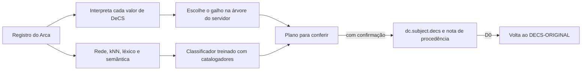

<p align="center">
  
</p>

<p align="center">
  
  
  
  
</p>

<p align="center">
  Correção e indexação automática de <b>Descritores em Ciências da Saúde (DeCS)</b> no <b>Arca</b>,
  o repositório institucional da Fiocruz, aprendendo com o trabalho dos catalogadores.
</p>

<p align="center"><a href="#english">English summary</a> · <a href="https://github.com/XbelchiorX/Arca-ODS">Arca ODS, o projeto irmão</a></p>

## O que é

O Arca DeCS conserta os descritores já atribuídos, coloca cada um no galho certo da árvore publicada no DSpace e sugere
os que faltam. Toda mudança passa por confirmação, fica registrada e pode ser desfeita.

## Como funciona



1. **Duas fontes, dois papéis.** A base DeCS 2026 da BIREME diz o que cada descritor *significa*. A árvore publicada no
   DSpace diz o que pode ser *gravado*.
2. **Consertar o que existe.** Cada valor é interpretado: caminho válido, nome do descritor, sinônimo, nome antigo, termo
   com qualificador ou termo fora do DeCS. O que não é DeCS vai para as palavras-chave.
3. **Escolher o galho.** Se o catalogador já escolheu, vale a escolha dele. Senão, um modelo combina o galho mais usado no
   acervo, a coerência com os outros descritores do item e o galho dos documentos parecidos.
4. **Atribuir o que falta.** Quatro sinais entram em um classificador treinado com o próprio acervo: rede multirrótulo,
   vizinhos já indexados (kNN), nome ou sinônimo no texto (léxico) e semelhança com a definição do descritor.
5. **Limiares medidos.** Os limiares de gravação saem da avaliação contra catalogadores em itens nunca vistos.

## Princípios

- 👩‍🔬 **O trabalho do catalogador não se perde.** O DeCS humano vai para `[DECS-ORIGINAL]` antes da primeira mudança.
- 🤖 **O modelo aprende só com humanos.** A saída da IA nunca vira exemplo de treino.
- 🌳 **Só se grava caminho que existe** na árvore publicada no servidor.
- 📏 **Mudou o método? Meça antes.** `ferramentas/decs/treinar_avaliar.py` mede contra os catalogadores.
- 🛡️ **O histórico é intocável.** `dc.description.provenance` nunca é alterado.

## Instalação

Requisitos: Python 3.11 ou mais novo e navegador Brave (login Microsoft do Arca). A GPU NVIDIA é recomendada para gerar os
embeddings.

```bash
git clone https://github.com/XbelchiorX/Arca-DeCS.git
cd Arca-DeCS
python -m pip install -r requirements.txt
```

**O que não vem no repositório:**

| O quê | Como obter |
|---|---|
| XML do DeCS 2026 (`bireme_decs_por2026.xml`) | Download na BIREME; salve em `dados/bireme` ou indique em `DECS_BIREME_DIR` |
| Árvore publicada no DSpace | Opção **D6** |
| Cópia local do acervo | Opção **D4** (só leitura) |
| Modelo treinado | Opção **D5** |
| Gerador do `decs.xml` (`script_conversao_decs_v2.py`) | Fica na pasta `DECS_BIREME_DIR`; só a opção **D7** usa |

## Uso

```bash
python executar.py
```

Para garantir que nada seja gravado, no PowerShell:

```powershell
$env:ARCA_SOMENTE_LEITURA="sim"; python executar.py
```

| Opção | O que faz |
|---|---|
| **D1** | Corrige e completa o DeCS de um registro e sugere o que falta |
| **D2** | O mesmo para uma lista de registros |
| **D0** | Devolve o DeCS de um item ao que o catalogador tinha |
| **R1** | Histórico do que foi gravado |
| **D4** | Atualiza a cópia local do acervo |
| **D5** | Retreina e mede o modelo |
| **D6** | Baixa a árvore publicada no DSpace |
| **D7** | Gera o `decs.xml` para o administrador publicar |

### O que cada ação do plano significa

| Ação | Significado | Grava? |
|---|---|---|
| MANTER | Já é um caminho válido | mantém |
| EXPANDIR | Termo do catalogador vira o caminho completo do mesmo descritor | sim |
| ATUALIZAR | Caminho antigo, sinônimo ou combinação oficial vira o caminho atual | sim |
| DESAMBIGUAR | Termo com vários descritores possíveis; o documento decidiu | sim |
| ADICIONAR | Descritor novo acima do limiar automático | sim |
| SUGERIR | Descritor novo para revisão humana | **não** |
| REVISAR | Ambíguo sem decisão segura | mantém |
| FORA_DA_ARVORE | Descritor sem lugar na árvore | mantém |
| PARA_PALAVRA_CHAVE | Não é DeCS: vai para `dc.subject.other` | sim |
| RETIRAR | Qualificador solto ou descritor repetido (fica no backup) | sim |

## Usar em outro repositório DSpace

1. Em `arca/config.py`, ajuste `BASE_URL`, os dados `OIDC_*`, `VOCABULARIO_DSPACE` e os campos.
2. Se o login não for Microsoft OIDC, adapte `login_no_navegador` em `arca/dspace.py`.
3. Rode D6, D4 e D5. O modelo aprende com a indexação humana **do seu** acervo; com menos de cerca de 5 mil itens
   indexados, espere qualidade menor.

## Pastas

```
executar.py         abre o menu
arca/decs_*.py      método do DeCS (vocabulário, interpretação, galho, indexador, rede, correção)
arca/ods_*.py       módulos compartilhados com o Arca ODS (LLM local e embeddings, usados nos descritores raros)
arca/dspace.py      login e acesso ao DSpace, com as travas de escrita
ferramentas/decs/   treino e avaliação, vocabulário e correções em massa
testes/             python -m unittest discover testes  (precisa do XML do DeCS da BIREME)
```

## Dados abertos relacionados

[Embeddings dos metadados do Arca com Qwen3-Embedding-8B](https://doi.org/10.5281/zenodo.23480451), no Zenodo (CC BY 4.0).

## Como citar

Use o botão **Cite this repository** do GitHub ou o arquivo [`CITATION.cff`](CITATION.cff).

## Marca

A marca Arca pertence à Fiocruz e aparece aqui só para identificar o repositório a que este projeto serve.

---

<a id="english"></a>

## English summary

**Arca DeCS** corrects and automatically assigns **DeCS (Health Sciences Descriptors, the BIREME vocabulary related to
MeSH)** in Arca, the institutional repository of the Oswaldo Cruz Foundation (Fiocruz, Brazil, DSpace 9.3).

It interprets each existing value, places it on the right branch of the tree published in DSpace, and suggests missing
descriptors with a classifier trained only on human indexing. It combines a multi-label network, nearest neighbours,
lexical matching and semantic similarity. Every change needs confirmation, is logged and can be undone, and the
cataloguer's original indexing is always preserved.

**Keywords:** automatic subject indexing, DeCS, MeSH, BIREME, controlled vocabulary, thesaurus, institutional repository,
DSpace, multi-label classification, kNN, embeddings, health sciences, Portuguese NLP, Fiocruz.
